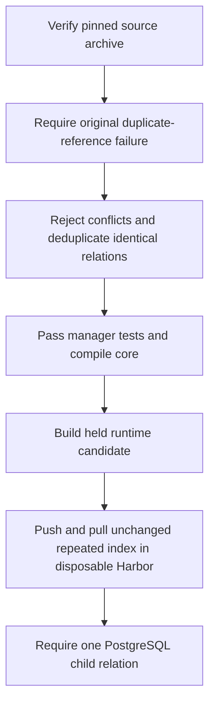
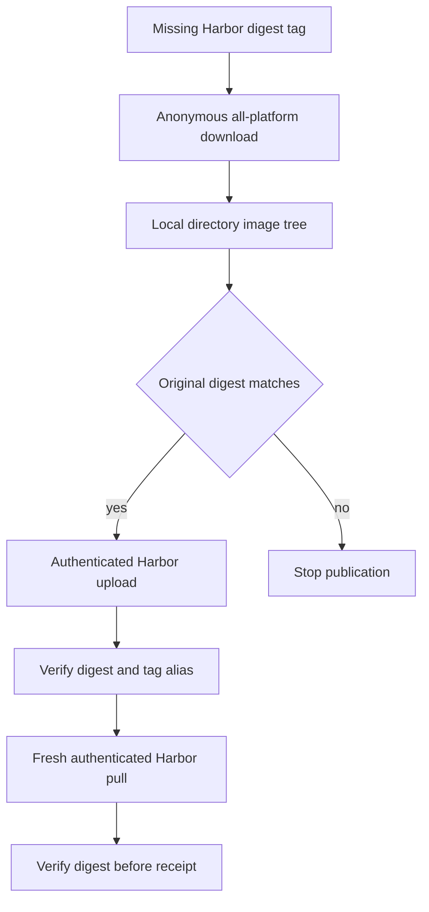

# Harbor Private OCI Registry

## Ownership And Access

Harbor registration inputs are declared in `IaC/stacks/harbor/stack.hcl`;
runtime state lives in
`clusters/homelab/apps/harbor`. The official chart is pinned to `1.19.2`
(Harbor `2.15.2`). Upstream component references remain digest-pinned; the
Talos mirror rollout redirects their pulls after all artifacts are copied. Fresh
bootstrap and registry recovery use the reviewed upstream rollback path.

The retained legacy `https://harbor.stinkyboi.com` path uses Cloudflare Tunnel,
the Octelium `harbor` WEB Service, and the shared Istio gateway until private
DNS acceptance. Octelium transport is anonymous and
passes Authorization headers; Harbor authenticates every private artifact
request. Browser login interception would break Docker, Helm, ORAS and
containerd. Harbor registration is disabled and only administrators can create
projects. The `homelab` project is private.

Phase 2a declares in-cluster DNS directly to Traefik, retaining the same
publicly trusted TLS identity. Talos/containerd uses host DNS and moves through
the separate guarded registry mapping below before external DNS changes.
Hosted CI still establishes a bounded Kubernetes port-forward to Istio with
the existing Octelium CI credential until phase 2b. Only its disposable runner maps
the Harbor hostname to loopback, bypassing Cloudflare upload-size limits while
retaining TLS verification. See `scripts/ci/harbor-publish.sh`.

The shared Octelium-to-Istio hop currently skips upstream certificate validation
for the Kubernetes Service hostname, as declared in
`docs/examples/octelium/homelab-services.yaml`. Public clients and CI still
verify Harbor TLS. A shared ingress hardening change should establish a trusted
upstream server name/CA and remove this bypass across the service catalog.

## Private node registry foundation

Before the October 10 rollout, read-only Talos inspection found no configured
registry mirrors or extra host entries on the four nodes. The strict mirror patches below remain
a separate rollout; the mesh migration must not activate them implicitly.

The staged Traefik `traefik-registry` Service reserves `10.96.0.50:443`.
Its dedicated listener permits only Harbor `/v2` descendants and the token
endpoint, preserves Authorization, and excludes management/dashboard routes.
The host-only patch resolves `harbor.stinkyboi.com` there on Talos while retaining
hostname-valid TLS. Cluster Service routing is required, so cold bootstrap
still needs upstream images before Kubernetes networking and Harbor are ready.

[`talos-harbor-mirrors.py --registry-host-only`](../../scripts/talos-harbor-mirrors.py)
preserves the live registry configuration and unrelated hosts. It defaults to
strict validation, uses the matching Talos executable, and requires exact reviewed
main for execution. Preflight checks the dedicated Service, TLS, registry/token
paths and dashboard denial before any node change. Roll out workers first;
correlate an uncached native node pull with Traefik/Harbor logs afterward.

Talos 1.11.3 can expose active `v1alpha1` without `persistent` after a STATE-only
boot. Every helper capture reads the full resource stream and compares all
active/persistent configuration documents when both exist. Missing persistent
is accepted only at initial active resource version 1. A staged/try difference,
changed active version without a counterpart, duplicate/unknown resource, read
failure, or absent active config stops the operation. The same checks run before
and after apply; scope, identity, no-reboot and native-pull gates remain intact.
Offline regression covers these cases without proving a live node rollout.

Flannel does not enforce the declared NetworkPolicy. Traefik's Istio policy
restricts registry sources to the four declared LAN node addresses and their
four individual `cni0` bridge plus four `flannel.1` overlay `/32`s on port 9443,
retaining the unauthenticated source restriction. Host-to-Service SNAT can select
a bridge locally or an overlay source across nodes; whole Pod CIDRs remain
excluded. Authenticated Talos reads confirmed bridges `10.244.1.1` through
`10.244.4.1` and overlays `10.244.1.0` through `10.244.4.0` on nodes `.199`
through `.202`, respectively.
Trusted node-local traffic still has Istio's bypass behavior. The listener's
path boundary and Harbor's artifact authorization remain required.

The first host-only mapping on `zimaboard-1` (`10.1.0.201`) was applied with
`NoReboot` and read back on October 10. Its uncached pull failed before Traefik:
ztunnel rejected source `10.244.3.1` at registry port 9443. The repository-owned
rollback subsequently removed that Harbor hosts entry without reboot, verified
in `/etc/hosts`. No successful private node pull is claimed. Merge and converge
the source-policy correction before retrying; hold remaining nodes and Harbor
DNS until every node passes an uncached pull with correlated registry logs.

On October 11, the first `zimaboard-2` host-only attempt timed out because
cross-node SNAT used overlay source `10.244.4.0`, which the earlier eight-address
policy omitted. Destination ztunnel logged six denials; Traefik received none.
The exact overlay addresses are now declared for port 9443 only. This source
repair is not successful pull acceptance: converge it before retrying and require
successful manifest/blob requests from the corresponding node, alongside the
native pull result. See the [dated incident](../../clusters/homelab/apps/traefik/CUTOVER.md#observed-cross-node-registry-rejection).

Separately, `zimaboard-2` rebooted and returned Ready at 21:29:52 UTC after a
21:13:45 NotReady event. At 21:31–21:32, authenticated Talos reads and all eight
scheduled Pods were healthy. The helper had rejected preflight before changing
that node. Bounded current-boot logs did not identify the cause; prior-boot
logs were unavailable. Require fresh all-node readiness and current leases
before retrying. If it flaps, retain prior-boot and hardware power evidence
privately; do not bypass readiness or issue an ad hoc reboot. The
[cutover record](../../clusters/homelab/apps/traefik/CUTOVER.md#observed-node-readiness-interruption)
keeps this as an unresolved observation, not durable recovery proof.
See the [host-only runbook](../../docs/harbor-image-mirroring.md) and
[ingress contract](../runbooks/tailnet-ingress.md).

## Identity And State

The SSM catalog declares twelve Harbor SecureStrings. `harbor-secrets` renders
the administrator, internal-service, encryption, database, and project-robot
values. The bootstrap Job reconciles the private `homelab` project with `pull`
and `publisher` robots and the public upstream-only `mirror` project with
separate `publisher` and `pull` robots. The publisher has pull/push permissions
and no artifact deletion; the reader has pull only. Source-controlled bootstrap
credentials stay outside this public repository.

The reviewed Stage A saved plan created and metadata-verified
`/homelab/harbor/mirror-robot-pull-password` without exposing its value. It made
only the reader parameter and identified exact-ARN reader-policy changes;
unexpected shared dependency changes remain outside scope. On clean reviewed
main, run `(cd IaC && terragrunt stack generate)` before entering the generated
`IaC/live/aws-ssm-parameters` unit for reader-plan review. The plan may create
the reader parameter and change only identified exact-ARN reader-policy entries,
including deterministic chunk creation or rebalancing; its wider shared
closure needs separate approval.

The Stage B desired-state consumer advances `harbor-secrets`' `OnChange`
revision to `v3` and mounts the reader key in the bootstrap Job. After External
Secrets materializes the target Secret, a bootstrap execution can create or
patch the reader robot. Require ExternalSecret Ready and successful PostSync
completion before accepting reader-robot, authenticated-receipt, or Talos
prerequisites. The Stage A parameter alone creates no robot, receipt-read
behavior, workload registry access, or node change. Do not use periodic refresh:
it would regenerate Harbor's salted bcrypt registry password hash. The public
`mirror` project remains public until a separate reviewed Talos path validates
authenticated pulls on every node before a privacy flip.

NOFX gets only the read-only robot through its namespace-specific SSM alias
`/homelab/nofx/harbor-pull-password` and `harbor-pull` Docker config Secret.
Retain the database, registry blobs, signing certificate and encryption key
as a recovery set. Database lives on a retained local volume pinned to `acer`;
registry blobs and logical database backups use retained QNAP NFS. Backups on
the same NAS are not independent blob disaster recovery. See the app README
for backup schedule, restore sequence and limitations.

## Image Scanning

The chart enables Trivy with a retained 5 Gi cache. The repository-owned
PostSync bootstrap sets and verifies `auto_scan: "true"` for the private
`homelab` and `mirror` projects on creation and subsequent syncs. New image pushes
trigger scans. Bootstrap also submits missing scans for retained private
`homelab` image artifacts, leaving existing reports and active scans alone and
excluding signatures and attestations. Verify completed reports after sync;
successful submission does not prove a successful scan.
Backfill traverses the complete repository/artifact inventory, including histories
over 1,000 artifacts; duplicate IDs and inconsistent pagination still fail closed.
The separate robot inventory retains its 1,000-object safety bound.
See `clusters/homelab/apps/harbor/README.md`.

Grafana receives `harbor_vulnerability_critical_total` from the repository-owned
Harbor vulnerability collector. It queries only completed scan summaries for the
`homelab` and `mirror` projects and emits aggregate counts per project, without
artifact names, digests, CVE IDs, or credentials in metrics. The Grafana rule
alerts at critical severity after five minutes for a nonzero count; absent data
and evaluation errors also alert. Cached metrics expire within six minutes of a
failed collection, and script revisions roll the collector through its
versioned pod-template annotation. The raw Grafana query preserves healthy
zero-valued project series while missing telemetry enters Alerting. A completed
Harbor scan that omits its zero-valued `Critical` severity bucket contributes
zero. Triage in
Harbor, then rebuild and roll out a
remediated image through GitOps. Source: `clusters/homelab/apps/harbor/vulnerability-exporter.py`,
`clusters/homelab/apps/harbor/vulnerability-exporter.yaml`, and
`clusters/homelab/apps/grafana/values.yaml`.

Grafana's `Security Overview` dashboard uses the same aggregate metric to show
critical-CVE totals and trend by project, affected-project count, collector
freshness, and scrape health. It intentionally remains aggregate; triage image
and CVE detail in Harbor. Missing telemetry shows an explicit orange warning
in the current-state stats; a successful zero count remains green. Source:
`clusters/homelab/apps/grafana/dashboards/security-overview.json`.

On 2026-10-04, Prometheus reported the collector target down because its
`/metrics` endpoint returned HTTP 503. The dashboard must show this as missing
scan data and one scrape target down; investigate collector-to-Harbor API
collection separately before treating a blank CVE total as healthy.

Read-only acceptance on 2026-09-28 found scan-on-push enabled in both projects
and Trivy v0.72.0 healthy. Both running NOFX images had successful reports:
backend `6dfec7dd502b` (5 critical, 65 high findings) and frontend `210a1bd9ca7e`
(2 critical, 58 high findings). Remediation requires reviewed dependency/base
image updates and rebuilt images; successful scanning does not imply no known
vulnerabilities. Six retained historical images had no report, motivating the
bootstrap backfill. On 2026-09-29, the automatic PostSync job applied
[PR #1101](https://github.com/Stuhlmuller/homelab/pull/1101) at `453e935c563d`.
All 26 retained private image manifests reported successful scans at 00:18 UTC,
with no missing, pending, running or failed reports. The last of the six
historical scans completed at 00:16:55 UTC; Harbor was Synced/Healthy.
The earlier in-progress
mirror copy had successful scans for all 62 uploaded runnable manifests and
16 indexes inspected; 15 unscanned objects were in-toto attestations. This
snapshot does not establish scan completion for images not yet uploaded.

## Scoped application image publication

`harbor-mirror.yml` accepts `image_scope=all` (the default), `chainguard`, `fleet`,
`bazarr`, or `traefik`.
Fleet uses the fixed `scripts/config/harbor-fleet-images.json` subset, covering
exactly its rendered Fleet, MySQL, Redis and bootstrap Python images. CI rejects
missing, extra or non-inventoried sources. All modes keep reviewed-main guards,
anonymous upstream reads, immutable digest checks and complete authenticated
Harbor pulls with the dedicated mirror reader. They use the same fixed
destination repositories.

Bazarr uses `image_scope=bazarr` with the fixed
`scripts/config/harbor-bazarr-images.json` subset: its Bazarr app image and
BusyBox init image. CI compares that subset with the Kustomize render and
app-template image declarations; the pinned app-template chart adds no default
containers. Missing, unused or non-inventoried sources fail validation. Publish
and verify these digests through `harbor-mirror.yml` at reviewed current `main`
before registering the Application. Talos mirrors keep `skipFallback: true`;
an upstream digest pin cannot make an uncopied image pullable. Scoped publication
preserves digest checks and complete authenticated Harbor pulls without coupling Bazarr to
unrelated historical images. See the
[Bazarr rollout](../../clusters/homelab/apps/bazarr/README.md).

Traefik uses `image_scope=traefik` with the fixed two-image
`scripts/config/harbor-traefik-images.json` subset of the reviewed full catalog.
It includes the ingress image and exact `pause:3.10` native node pull probe.
It preserves all-platform digest copying, the reviewed tag alias and fresh
complete authenticated Harbor pulls. No caller-supplied image, path or destination is
accepted. Successful publication is required before the consuming ingress
rollout; it establishes only this subset's availability.

Run titles record the selected scope and full revision. Full-catalog Talos
mirror verification requires `Mirror all @ <run head SHA>` and the unchanged
publication bundle. Scoped, untitled and mismatched-revision receipts fail
before registry checks; dispatch `image_scope=all` when full-catalog evidence
is absent. See `scripts/talos-harbor-mirrors.py` and the
[publication runbook](../../docs/harbor-image-mirroring.md).

The full-inventory workflow has no verified successful run as of October 3.
Run `36511537440` failed after 75 minutes copying an unrelated Python image
with sanitized category `transport-failed`; that missing digest remained in the
148-image inventory. Fleet's initial rollout therefore uses the fixed scope to
avoid coupling deployment to the full historical mirror audit. This does not
establish full-inventory mirror completion.

## Image Publication

### October 11 duplicate-index failure

Full-catalog runs `38108370598` and `38117127796` failed at the pinned LiteLLM
database index. Its eight descriptors repeat four child digests twice. The
second run's parent-index write correlates with PostgreSQL `unique_reference`
failure at `08:53:38.389Z`, matching
[Harbor issue #16718](https://github.com/goharbor/harbor/issues/16718).
Child writes succeeded, but the parent was unavailable by digest and either tag.
Keep immutable source bytes and attestations intact; no live schema repair or
index normalization is part of the ingress cutover.

The two-image Traefik scope can publish the native probe independently of this
full-catalog incompatibility. A scoped receipt still proves only selected image
availability. Native pulls on every node remain required before Harbor DNS
changes; global `skipFallback` mirrors still require full publication. See the
[recorded failure and repair boundary](../../docs/harbor-image-mirroring.md#duplicate-index-publication-failure).


### Identical-reference core repair candidate

The [maintained core recipe](../../builds/harbor-core/README.md) pins upstream
Harbor v2.15.4 source and its archive hash, the official amd64 runtime image and
a public Chainguard Go builder. Its source patch deduplicates only identical
database relations for the same child. Differing digest, platform, URL or
annotation metadata fails before any DAO write. The artifact digest and
descriptor list remain intact; this repair changes no registry index bytes or
database schema.

The recipe verifies the archive before safe extraction and checks all three committed
patches. Native tests reproduce the unpatched unique-reference failure, then
require the repaired manager suite and complete core compilation. API bindings
use upstream's pinned Swagger v0.33.1 and templates. Image build tests run
without networking after dependency download; the runtime preserves the
upstream payload, user and entrypoint and declares its loopback health probe.

The [disposable registry fixture](../../builds/harbor-core/registry-test.py)
then prepares pinned v2.15.4 services with this candidate core. It publishes no
host ports; the service network denies external traffic. The test client shares
the proxy's network namespace and uses `127.0.0.1:8080`. Proxy and jobservice
startup waits for the candidate core's health check. Eight
identical OCI child descriptors must survive a push and complete pull unchanged,
including the child manifest and both blobs. The PostgreSQL query requires one
parent/child relation. Temporary credentials, containers, network and data are
fixture-owned and removed on exit. This gate uses no production inputs; passing
it remains separate from original full-catalog and live publication acceptance.



The candidate's build gate checks original failure and repaired behavior before
creating an image; it does not authorize rollout.

No active consuming image, credential producer or live database changes are included.
Linux image build, disposable Harbor/PostgreSQL index push/pull with unchanged
digests, complete private scans and protected publication remain gates. Couple
any v2.15.4 rollout with matching chart/components and verified database/blob/key
backups. Keep the upstream cold-bootstrap and rollback paths. Source-manager
tests alone do not establish real database, registry, CVE or workload acceptance.

On 2026-10-11, [candidate CI at `e3f58417`](https://github.com/Stuhlmuller/homelab/actions/runs/38164012314/job/114542676251)
passed Linux build and the isolated registry/PostgreSQL fixture: eight index
descriptors, child manifest and both blobs remained unchanged, with one database
relation. This is fixture acceptance, not full-catalog publication or deployment.
The [sanitized fixture receipt](../../docs/evidence/harbor-core-registry-fixture-2026-10-11.json)
retains the job/head/index identities and log hash without runtime credentials.

The same day's [sanitized base-scan receipt](../../docs/evidence/harbor-core-base-scan-2026-10-11.json)
records a separate local Grype 0.112.0 audit of the pinned upstream v2.15.4
runtime base. Original manifest/config/blob hashes were checked; the fresh
database was valid and no finding filters or exclusions were enabled. It found
32 Go package matches across 26 advisory IDs: three critical, 15 high, six
medium, two low and six unknown severity. Twenty-six matches report fixes;
four report no fix and two have unknown fix state. These are scanner matches,
not proven exploitability or results for the rebuilt candidate. Remediate the
compiler/dependency findings, inspect unresolved advisories against source and
reachability, then scan the exact rebuilt Linux image before publication.

The [dependency patch](../../builds/harbor-core/patches/0003-security-dependencies.patch)
requires Go 1.27.2 and pins resolved updates for NTLM, networking, crypto, Helm,
telemetry and compression. It replaces gorilla/csrf with the advisory-recommended
`filippo.io/csrf/gorilla` compatibility package. Browser protection now checks
origin/Fetch metadata; response token headers remain, but tokens are ignored and
nonbrowser requests remain allowed. The declared key contract and invalid-key
refusal stay intact. The complete middleware suite and ten
[browser/session compatibility cases](../../builds/harbor-core/csrf-compat_test.go)
passed locally against Harbor's actual middleware.

The [rebuilt Linux binary receipt](../../docs/evidence/harbor-core-binary-scan-2026-10-11.json)
still records five matches: four Distribution v2 advisories and one x/crypto
advisory, all unfixed/unknown (two high, two medium, one unknown severity).
This binary-only audit is separate from the upstream base audit and final
container acceptance. Inspect and remediate these remaining findings; rerun
the Linux image/registry fixture after the dependency change and scan the exact
final container before protected publication. Do not filter away unresolved findings.

The [advisory assessment receipt](../../docs/evidence/harbor-core-advisory-assessment-2026-10-11.json)
adds precise evidence for this local core binary. Its package graph excludes
OpenPGP and the Distribution proxy/storage/handler server packages implicated
by the reported advisories. Go's binary analyzer reports only a module-level
OpenPGP advisory, without an affected package/symbol trace. A native JWK attack
test accepts a trusted key and rejects attacker key material with a forged
trusted key ID; the primary JWK advisory targets Distribution v3 prereleases.
The build now guards the package exclusions and reruns that trust test.
All five raw Grype matches remain recorded. These assessments cover this core
binary only: registry daemon/configuration, the final container, changed future
dependencies and deployed workloads still need independent verification.

The [full-runtime audit](../../builds/harbor-core/scan.sh) now saves the exact
Linux candidate from Docker after registry acceptance and scans the complete
archive with lock-pinned Grype. Its [report checker](../../scripts/ci/harbor-core-scan-check.py)
verifies the config hash against the inspected image ID, platform/distro,
fresh report/database and absence of filtering, exclusions or VEX input.
Available fixes fail this audit. Unfixed/unknown matches remain counted;
successful collection does not mean CVE clearance or authorize publication.
CI emits only an identity/report-hash/database/severity-count receipt while
raw metadata and transport logs stay private and temporary inputs are removed.

The [full-container receipt](../../docs/evidence/harbor-core-full-runtime-audit-2026-10-11.json)
records successful Linux audit CI at `279092e6`, with exact image/config identity
`06e82a8d...09ef9` and five retained matches (two high, two medium, one unknown).
The available-fix gate passed; CVE clearance remains explicitly false.

The [excluded private-core pull candidate](../../clusters/homelab/apps/harbor/private-core-candidate/README.md)
renders a namespace-local Docker-config ExternalSecret and ServiceAccount pull
reference from the already-declared `/homelab/harbor/robot-pull-password`.
Harbor is already permitted by the store and exact reader policy. No app-container
mount, new IAM/SSM declaration or credential rotation is added. Active Harbor
resources exclude this directory. Move its secret and merge the pull reference
into the existing ServiceAccount only with reviewed publication/scans, recovery
clearance and ExternalSecret readiness; preserve cold-bootstrap/rollback access.

The dispatch-only [Harbor Core Images workflow](../../.github/workflows/harbor-core-images.yml)
prepares a protected publication path for one fixed
`homelab/homelab-harbor-core:homelab-<main-sha>` reference. It checks current
main before checkout/build and again before credentials, rebuilds/tests/audits
first, and uses `homelab-production` with the shared Harbor publication lock.
The helper also requires that dedicated workflow reference. After push, a fresh
complete private pull and digest comparison precede in-cluster signing and
destination verification against the enrolled public-key fingerprint.
Failures withhold the output digest; success produces a pinned-reference artifact.
Core signing Pods use only the pinned Harbor Cosign mirror, whose publication
must be verified before dispatch. NOFX's two-subject behavior remains intact.
Before registry credentials, the [Linux compatibility fixture](../../builds/harbor-core/signer-test.sh)
tests the pinned public Chainguard Cosign candidate for P-256 import/public-key
identity and signing flags. The protected publisher then replaces every core
signing-Pod container image with the same digest mirrored in Harbor.
The [2026-10-11 receipt](../../docs/evidence/harbor-chainguard-signer-pull-2026-10-11.json)
proves a complete read-only Harbor pull of that exact index, its two platform
manifests and 18 referenced config/layer blobs. It does not prove source-signature
transfer or Linux compatibility acceptance. This path does not authorize dispatch,
activate the held consumer, or clear shared recovery/advisory gates.
Current-main source staging also applies the fresh private pull prerequisite to
both retained NOFX subjects; its anonymous source download and alias checks
remain independent of this fixed core-only mode.

### Cloudflared 2026.9.3 prerequisite (HOME-17)

[PR #1128](https://github.com/Stuhlmuller/homelab/pull/1128) at
`6e2cdd6ef586e6c312d4982cdbee966041489de9` changes only the consuming
cloudflared image. Its [static gate](https://github.com/Stuhlmuller/homelab/actions/runs/36666881786/job/109733342718)
rejects the missing catalog image and digest
`sha256:072c067d25ccbe61d46e18f0d0723255f2bb5304f7317caa95b27031520ff92c`.
This is catalog drift; no policy or workflow exception is needed. The two
September 30 scheduled findings observed the same failed execution.

The prerequisite catalog addition retains 2026.9.1 for rollback and leaves
the consuming Deployment unchanged. Anonymous Docker Hub manifest reads on
2026-09-30 verified that both the 2026.9.3 tag and digest hash to the proposed
743-byte multi-platform manifest (Linux amd64 and arm64). This proves upstream
manifest identity, not complete Harbor publication or live pull availability.

Require review and successful static/policy CI before an explicitly approved
prerequisite merge. Then obtain separate approval to dispatch
`harbor-mirror.yml` on exact reviewed current `main`, with matching
`expected_sha`, using the existing protected environment. Require complete
authenticated Harbor pulls and digest/alias verification before approving the
consumer upgrade. An older publication run cannot cover this changed catalog.
Rebase the consumer onto the prerequisite and require current-head static
success; keep HOME-17 open until two consecutive scheduled observations also
report success. A green catalog check alone does not establish publication.

On publication failure, hold the consuming PR and retain 2026.9.1. Before the
consumer merges, a reviewed revert of only this catalog addition is sufficient
to withdraw the proposal; do not delete copied artifacts. After the upgrade,
rollback requires an approved declarative revert to the retained 2026.9.1
image, followed by tunnel/readiness and existing route checks. Do not relax
strict mirrors or change operator access as part of this fix. See
[the publication runbook](../../docs/harbor-image-mirroring.md#updates-and-coverage).
Current-head CI success, publication, scheduled recovery and live health remain
unverified by this investigation.

New NOFX builds publish to Harbor after the existing build and reviewed-main
gates. The publisher emits only the two verified current-revision image references
as job outputs. A separate credential-free job validates them again and uploads
one fixed text file, retained for 30 days, for `gh run download`; private logs and
registry credentials remain outside artifacts. The live-job artifact upload ban
is unchanged. See the [NOFX build recipe](../../builds/nofx/README.md#publish-update-and-revert)
for the artifact name and CLI retrieval command.

At the pre-cutover inspection on 2026-09-19, NOFX still used upstream images.
The initial maintained Harbor rollout then merged in PR #1036 at `78ca869` and
was verified Synced/Healthy with both `f76c278` images ready. See
[NOFX](../apps/nofx.md).
for runtime evidence and `clusters/homelab/apps/nofx/deployment.yaml` for current
desired references. Later source builds require a separate functional rollout.
first verify copies and read-only pulls, then preserve that consumer's exact
digest while changing its registry through GitOps. The later cluster-wide
mirror rollout below extends this to third-party images.
## Rollout And Acceptance

1. Validate static checks, rendered chart/manifests and Terragrunt plan. Merge
   through the repository's signed-commit and review gates.
2. From a clean checkout of exact merged main, regenerate the Terragrunt stack
   and plan/apply only `IaC/live/aws-ssm-parameters`, then
   `IaC/live/argocd-apps/harbor`. Review saved plans and run Conftest before
   applying; reject deletes, replacements, or unrelated changes. The shared
   SSM unit must be inspected for earlier drift before calling it Harbor-only.
   The earlier Azure credential gap is resolved; [full apply 37586972225](https://github.com/Stuhlmuller/homelab/actions/runs/37586972225)
   advanced the current checkpoint. Use the unit-level path for scoped Harbor
   changes, not to bypass a presumed Azure blocker. Require healthy external
   secrets, storage, PostgreSQL and the bootstrap Job.
3. Follow the [ordered private DNS cutover](../../clusters/homelab/apps/traefik/CUTOVER.md)
   from exact reviewed main after registry-node acceptance. The old public DNS
   writer and restoration workflow are removed. Retain the legacy Service and
   Tunnel only for remaining callers and reviewed rollback until acceptance.
4. Verify HTTPS, API health, `/v2/` authentication challenge, private project
   settings, denied anonymous artifact access and authenticated pull/push.
5. Publish the exact reviewed custom-image revision and require complete
   authenticated pulls plus denied anonymous access. Update consuming digests
   through GitOps and pass the application's functional acceptance checks.
6. Require a completed verified database backup, retained PVCs and documented
   restore limits before reporting operational readiness.

Retained legacy Service recovery only (review the exact SHA before running):

```sh
expected_sha='<reviewed-current-main-sha>'
test "$(git rev-parse HEAD)" = "$expected_sha"
test -z "$(git status --porcelain=v1 --untracked-files=all)"
test "$(git ls-remote origin refs/heads/main | cut -f1)" = "$expected_sha"
nix develop --command python3 -I scripts/octelium-harbor-reconcile.py \
  --execute --expected-sha "$expected_sha"
```

The helper defaults to read-only without `--execute`. Execution selects only
`harbor.default`, requires exact clean reviewed main, reuses the pinned native
TLS carrier, verifies a second apply has no change, and reads back its access
contract. It never creates operator credentials or applies the entire catalog.

## Current Evidence

Harbor rollout was independently verified on 2026-09-20 UTC at main
`7a59f266eb0c776c97dc9bc72132e91d2a4dc09d`, merged through
[PR #1046](https://github.com/Stuhlmuller/homelab/pull/1046).
[Repository validation](https://github.com/Stuhlmuller/homelab/actions/runs/35486057081)
and [static policy/security checks](https://github.com/Stuhlmuller/homelab/actions/runs/35486057091)
passed; the corrected VirtualService also passed a live server-side dry run.

- Argo CD was Synced/Healthy with a successful operation at that exact revision.
  All nine workload Pods were Ready, all six PVCs were Bound, and the
  ExternalSecret and token-signing certificate were Ready.
- Public HTTPS passed certificate verification; the native Harbor login page
  rendered, and authenticated administrator API reads succeeded. Registration
  is disabled, project creation is administrator-only, `homelab` is private,
  and both project robots have their exact declared permissions.
  Anonymous `/v2/` returned HTTP 401 with Harbor's native Bearer challenge.
- The bootstrap and initial database-backup PostSync hooks succeeded. The
  initial dump passed archive and checksum verification. Nightly backups are
  enabled at 03:35 America/Los_Angeles; the nightly schedule has not yet run.
  This proves a logical metadata backup, not an independent registry backup
  or a completed restore drill.
- All four Prometheus targets (core, exporter, jobservice and registry) were
  UP without scrape errors; live namespace selection includes Harbor.
- The protected [current-main publisher](https://github.com/Stuhlmuller/homelab/actions/runs/35486181588)
  built and pushed both custom images to Harbor and verified destination
  digests. Future custom builds use this same private OCI path.
Python's default urllib User-Agent received HTTP 403 from the public endpoint.
The same HTTPS request with the descriptive
`homelab-harbor-acceptance/1.0` User-Agent returned the expected Harbor response;
curl also succeeded. Acceptance uses that explicit User-Agent without relaxing
TLS verification. The public Skopeo full-pull checks above also passed. Local
Nix/macOS Skopeo needed a temporary trust policy for these unsigned images:
default reject, with acceptance limited to the two exact repositories; expected
digests remained mandatory. No system policy was changed.

Two rollout failures refined validation: ESO 2.0.1 requires an explicit
`bcrypt` argument to `htpasswd`, and the installed Istio CRD rejects
`timeout: 0s`. The VirtualService omits timeout (disabled by default) and sets
`retries.attempts: 0` to prevent replaying writes. See the
[Istio HTTPRoute reference](https://istio.io/latest/docs/reference/config/networking/virtual-service/#HTTPRoute).
Static rendering did not catch either runtime validation issue.

## Expanded publication and egress prerequisites

Both publication catalogs list thirteen digest-pinned `cgr.dev/chainguard/*`
sources. Go, nginx, Node runtime, Node dev, static, and Wolfi base are the six
additions to the original seven-image scope. Earlier seven-image receipts exclude
those additions, so expanded publication requires protected approval and complete
authenticated Harbor-pull acceptance before a consuming change. Public sources belong
in the catalog; application runtime references must use Harbor.

For a missing destination digest tag, the
[publisher](../../scripts/ci/harbor-publish.sh) downloads all upstream platforms
anonymously into a local directory image tree and checks the original manifest
digest before authenticated Harbor upload. Existing destination tags resume
only after exact hash verification. Aliases come from the verified Harbor digest;
every selected artifact still needs a fresh complete authenticated destination pull.
The [native offline regression](../../scripts/ci/harbor-publish-test.py) checks
both architecture children and repeated index descriptors through directory
staging and a second copy. Its generated local OCI fixtures reject network
transports; this proves local transport behavior, not Harbor acceptance or
publisher signatures.



Missing-artifact publication verifies source bytes before upload and independently
checks the complete destination download.

The [full catalog](../../scripts/config/harbor-images.json) contains digest-pinned
Image Updater v1.3.0 and Kubernetes SIG Network `kube-network-policies` v1.1.2.
Image Updater stays paused at zero replicas, and neither cataloging nor publishing
the enforcer activates a DaemonSet. Flannel remains the transport and does not
enforce existing NetworkPolicies. The enforcer is the proposed L3/L4 boundary
behind Istio egress waypoints; activation requires repository-owned Talos NRI
configuration, live socket/plugin registration, negative startup/bypass tests,
review of every NetworkPolicy, and a fail-closed strict-mode worker canary.
Preserve DNS, API, HBONE, webhook, storage, and recovery paths and prove direct-IP,
alternate-port, IPv6, and gateway bypass denial before expansion. See
[image and egress gates](../../docs/image-egress-hardening.md) and
[runtime isolation](../runbooks/runtime-isolation.md).

No consumer migration, full-catalog publication, zero-CVE result or live egress
enforcement is established by these prerequisites. Image pulls remain
node/containerd traffic, outside Istio pod interception.

## Proposed Chainguard automation

The [Chainguard image automation specification](../../specs/002-chainguard-image-automation/spec.md)
proposes migrating all compatible active workloads, recording exceptions,
automatically importing Chainguard releases into Harbor, and restoring Argo CD
Image Updater for digest-pinned updates committed directly to `main` by a GitHub
bot. The user requested this scoped exception to routine image-update PRs;
publication and exact-candidate validation must pass before the bot advances
`main`. Enrollment and permission changes retain normal review. Automatically
merged PRs are the fallback if a scoped direct-write path is not feasible.
Enrolled workloads would follow any stable release, including major upgrades,
subject to compatibility and recovery checks; prereleases and known incompatible
candidates remain excluded. It preserves publish-before-consume verification,
source provenance, restricted-image access, and rollback. Enrolled images would
transfer update ownership from Renovate; other dependency updates would remain
with Renovate. Failed updates would revert automatically only with verified
compatibility between the retained image and current data, blocking the failed
digest from reapplication. Unsafe or unknown compatibility and failed rollback
would pause affected-application updates and alert the operator; data restores
remain operator-led.

The [implementation plan](../../specs/002-chainguard-image-automation/plan.md)
uses exact-name native Harbor replication rules: Chainguard's anonymous catalog
API is unsupported, but known repository tag listing works. A verifier advertises
only completely downloaded digests through a separate Harbor alias. Image
Updater proposes changes; a separate CI-only bot validates a signed candidate
before advancing main. Explicit Harbor references preserve source provenance
without adding a new Talos upstream-mirror rule.

Direct promotion requires a companion reviewed change in `Stuhlmuller/github-iac`,
the owner of repository rulesets and environment protections. The proposed bot
bypasses PR governance only; signatures and genuine checks remain required.
Existing protected environments retain reviewers. Fresh proposer credentials
and a separate CI-only promoter are activation prerequisites.

The [implementation tasks](../../specs/002-chainguard-image-automation/tasks.md)
separate an import-only MVP from workload migration and bot activation. Direct
updates stay paused until the independent checks and recovery readiness pass.
Routine updates, bound rollback and control-only pause/rejection have distinct
eligibility gates, so recording a failure cannot block its own safe recovery.
Release metadata verification ships in the import phase. Compatible non-Argo
images still migrate through their current reviewed owner; only updater
eligibility is exempt. Release-sample acceptance and recovery drills run
independently after activation, and both remain required for completion alongside
the full migration assessment beyond the stateless pilot.

The [initial inventory](../../specs/002-chainguard-image-automation/migration-inventory.md)
identifies the stateless Python Harbor vulnerability exporter as the first
candidate. It also records a parser finding: `scripts/harbor-image-inventory.py`
matches across the embedded Helm `image:`/`tag:` newline in
`clusters/homelab/platform/storage/cordium-local-path-provisioner-application.yaml`,
inventing `docker.io/library/tag:latest`. Fix the shared parser with a regression
case, then reconcile all pinned chart renders and read-only runtime images
before claiming complete migration coverage.

The implementation is staged in repository desired state: public Chainguard
replication is active, the Python and Kiali enrollments are candidates, the
updater remains paused, and deterministic contract checks plus the main-owned
verification workflow are present. Workload migration, bot promotion, and
live acceptance remain paused until their gates pass; existing images still use
the manual reviewed publication path.
Read-only planning verified selected public registry access and GitHub protection
constraints; it did not establish organization entitlements or runtime
compatibility. Preserve the failure context in
[the image automation runbook](../runbooks/image-automation.md) and
[the mirror runbook](../../docs/harbor-image-mirroring.md) while implementing the plan.

## Sources

- [Official chart](https://github.com/goharbor/harbor-helm/releases/tag/v1.19.2)
- [Harbor OCI support](https://goharbor.io/blog/harbor-2.0/)
- `clusters/homelab/apps/harbor/README.md`
- [Storage And State](../architecture/storage-and-state.md)
- [Secrets And Identity](../architecture/secrets-and-identity.md)
- [GitOps Flow](../architecture/gitops-flow.md)

## Private Signing Rollout

New publications use the local P-256 key in the cert-manager-owned
`harbor-image-signing` Secret. `rotationPolicy: Never` preserves signer identity
through certificate renewal. `scripts/ci/harbor-publish.sh` creates the fixed
`signing-job.yaml` template for its two verified image digests. The Job mounts
the key inside the cluster; CI reads only its public key from successful Pod
status, checks its SHA-256 against `scripts/config/harbor-signing.json`,
and verifies both signatures. The enrolled fingerprint pins the independently
retained public key; an unset (`null`) fingerprint still fails closed. No AWS
signing resource, public signing service or transparency-log submission is used.
Existing registry credentials still follow the SSM/ExternalSecret contract above.

The Job has no API token and declares DNS/Istio egress. That NetworkPolicy is
not enforced by the current flannel CNI, and Harbor is not mesh-enrolled. A
compromised signer could exfiltrate its mounted private key and publisher
credential. This is an open isolation finding, not an enforced key boundary;
source: `docs/runtime-isolation.md` and the signing Job/NetworkPolicy. Before
claiming egress isolation, add a repository-owned enforcing dataplane, validate
DNS/Harbor access, and prove arbitrary external destinations are denied from
the signer. Pinned code, no API token, and a short lifetime do not replace that
control.

Temporary imported keys live
in memory-backed storage; finished Jobs expire after ten minutes. Namespace
Pod creators and cluster administrators remain trusted. Protect the signing
Secret in encrypted off-node etcd backups, retain public keys independently,
and restore the Secret before cert-manager after a disaster. PostgreSQL backups
do not cover the signing key. See `builds/nofx/README.md` for recovery and rollback.

Status: the retained signer's fingerprint is enrolled. Backup verification
receipts and the independently retained public key stay in private operator
storage. [NOFX Images run 36350207462](https://github.com/Stuhlmuller/homelab/actions/runs/36350207462)
completed the first signed publication and verified both stored signatures
against the enrolled fingerprint for source
`f0a60ec70b43e5e5b5a9691b4f59358d13089b7d`.
[NOFX Images run 36368577201](https://github.com/Stuhlmuller/homelab/actions/runs/36368577201)
published and verified the follow-up source
`e7014c8b9644a6c13d909373eda3c572c1cdba00`, including the `0015` protection fix.
Runtime rollout acceptance remains separate from publication; independent
operator signature verification remains pending.
Historical artifacts and pull/admission enforcement remain unchanged.

## Cluster-wide Image Mirror

The [mirror runbook](../../docs/harbor-image-mirroring.md) owns copying, cutover and
recovery. `scripts/config/harbor-images.json` captures public upstream digests
from repository declarations, rendered charts and live Pods/system images. The
protected `harbor-mirror.yml` workflow copies all platforms into the normal
public-read `mirror` project and verifies complete authenticated Harbor pulls. A completed
ancestor publication is reusable only with the runbook's six publication files
unchanged; node rollout still requires exact reviewed `main` and live digest
checks. Its publisher uses a separate generated
`/homelab/harbor/mirror-robot-push-password` for writes and the reader parameter
for destination receipts; the
[initial publisher plan](../../docs/harbor-image-mirroring.md#initial-secret-plan-scope)
is its prerequisite. The [reader prerequisite](../../docs/harbor-image-mirroring.md#mirror-reader-prerequisite)
has created and metadata-verified the parameter, but it does not prove GitOps
reconciliation, publication, or node authentication. Private `homelab` artifacts
retain their existing authentication/signing contract.

The [first copy](https://github.com/Stuhlmuller/homelab/actions/runs/36382200622)
and [retry](https://github.com/Stuhlmuller/homelab/actions/runs/36388691071)
stopped during the second upstream copy used for PostgreSQL tag aliases (17.5,
then 14.23). Destination digest uploads and readback
had succeeded; Harbor showed no concurrent error or resource pressure. Deleted
private client logs prevented proving the underlying failure. The publisher now
creates aliases from the verified Harbor digest and resumes already-present
digest tags only after exact hash comparison. Complete authenticated Harbor pulls
still run for every entry. Failures expose fixed phase/status/category metadata
and the public catalog source, never raw transport output. This removes the
observed second external transfer.

[Recovery run 36506302738](https://github.com/Stuhlmuller/homelab/actions/runs/36506302738)
passed both PostgreSQL alias failures and completed the first 31 catalog entries,
then stopped at the missing PostgreSQL 18.4 digest tag. Live read-only probes
confirmed Harbor returns HTTP 404 with `NOT_FOUND` and an exact artifact or
repository `not found` message, rather than registry manifest/name-unknown.
The publisher now recognizes only those additional messages naming the expected
mirror repository and, for an artifact, its exact digest tag. Generic 404s and
messages naming other content still fail closed. Complete publication and node
cutover remain pending.

During the earlier mirror-publisher rollout, `harbor-secrets` reconciled before
its SSM parameter existed. The approved scoped plan applied 16 creations and
three IAM updates, with no deletions or existing-secret rotations. Its GitOps
`generated-secret-revision` advanced to `v2` to reconcile the publisher
credential. The reviewed reader parameter later existed as a separately scoped,
metadata-verified Stage A apply. The current desired-state consumer advances to
`v3`; it must report Ready and the PostSync bootstrap must finish before
accepting reader-robot, authenticated-receipt, or Talos prerequisites. Keep
`refreshPolicy: OnChange` to avoid periodically regenerating the salted bcrypt
registry password hash; an annotation change alone is not readiness evidence.

`.talos/patches/harbor-mirrors.yaml` and the validated
`scripts/talos-harbor-mirrors.py` path redirect containerd for all inventoried
registries, covering controller-generated Pods and Talos system images.
After a successful full-catalog receipt, the credential materializer writes only
the reader robot JSON into an existing owner-only directory outside a Git
checkout. The Talos helper accepts that fixed `--registry-auth-file`, rejects
symlinks and unrelated existing Harbor auth, and removes only its owned auth on
rollback. Authenticated Talos calls explicitly select the private
`.talos/talosconfig` or the operator-provided `--talosconfig` path; absent files
fail before networking. Talos skips cached pull references. The cutover probes pause in the `system`
namespace, where it was absent on all four nodes during this rollout. System
images and CRI share the mirror configuration; correlate the pull with Harbor
access logs, since repeating an already-cached probe proves no new request.
`skipFallback: true` prevents silent upstream pulls. Apply only after publication;
new image/chart versions need a prerequisite catalog publication. The rollback
patch restores upstream access for cold bootstrap or Harbor recovery. Existing
public DNS transport remains; this does not establish network isolation.

An ordinary `--execute` requires the materialized reader credential unless the
captured configuration already has valid `robot$mirror+pull` auth. Any other or
absent auth stops before a candidate configuration or `apply-config`. This gate
does not itself change `mirror` project privacy.

Initial inspection on 2026-09-28 UTC: all four nodes Ready, Harbor Synced/Healthy;
OpenClaw had unready app/proxy containers before this change. The 145 catalog
entries passed anonymous upstream manifest/digest verification. All four current
Talos configurations passed strict mirror-patch validation. Harbor registry NFS
reported about 901 GiB available (shared filesystem capacity, not a PVC quota);
no storage expansion was needed for this preflight. The shared SSM plan includes
pending AI secrets; the
[publisher target plan](../../docs/harbor-image-mirroring.md#initial-secret-plan-scope)
limits initial publication to `/homelab/harbor/mirror-robot-push-password` and
documents shared IAM/random state dependencies requiring explicit operator
approval. The later
[reader target plan](../../docs/harbor-image-mirroring.md#mirror-reader-prerequisite)
is a separate Stage A prerequisite. Image transfer and node cutover remain
pending; source verification is not migration evidence.

## PostgreSQL 17 pgvector update (HOME-49)

PR #1143 requires the `ac08538` index in the catalog before its consumers
can advance. Keep the prior `cf134a7` index and `pg17` alias for recovery;
the new entry is digest-only. Publication must complete before the consumer
PR merges. See [compatibility, validation and rollback gates](../../docs/pgvector-pg17-update.md).
Registry metadata verifies PostgreSQL 17.11 on both images and pgvector
0.8.6 → 0.8.7 in build history; runtime extension and restore acceptance
remain unverified. Catalog coverage is desired-state evidence only.
