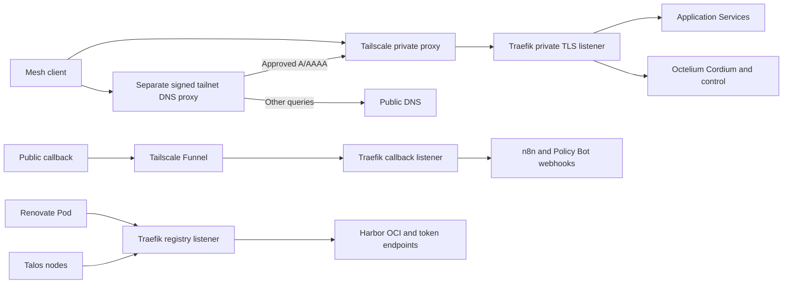

# Tailnet And App Ingress

The staged migration declares Traefik as the reverse proxy for private
application URLs. Fleet devices and administrators use the Tailscale mesh;
Fleet has no Funnel route. Octelium remains for Cordium and its required portal,
API and console. Existing DNS and Cloudflare transport remain until cutover
acceptance; foundation source alone does not establish deployed traffic changes.

Canonical desired state and validation:
[Traefik README](../../clusters/homelab/apps/traefik/README.md),
[route inventory](../../clusters/homelab/apps/traefik/routes.yaml), and
[Tailscale provider runbook](../../IaC/terragrunt-catalog/modules/tailscale-access/README.md).
The [ingress runbook](../../docs/networking-tailnet-ingress.md) describes the
phase 2a source and the separate external DNS and later CI cutover gates.



Separate listeners prevent public callbacks from selecting private routers.

## Route boundaries

`traefik-private` receives mesh traffic for the existing private custom hostnames;
cert-manager supplies their public-trust TLS certificate. `homelab-ingress` is
the Tailscale device name. Explicit file-provider routes select fixed Services;
Traefik does not discover arbitrary workloads. Fleet's setup paths remain denied.
The staged OpenClaw Enterprise console uses `console.oce.stinkyboi.com` through
an authenticated Octelium Service. Only exact
`agent-<32 hex>.agents.oce.stinkyboi.com` hosts go directly to the OCE API on
this private listener; OCE checks the session and Agent permission. The old
`openclaw.stinkyboi.com` route still targets the suspended legacy Service until
final cutover. The certificate explicitly includes the console name and the
`*.agents.oce.stinkyboi.com` wildcard; `*.stinkyboi.com` cannot cover the
two-label console name. These declarations do not establish live access.
The current single-stack IPv4 Service publishes only `100.99.16.74`; its peer's
IPv6 address has no matching application forwarding rule. The separate resolver
uses the Traefik Service's published IPv4 for approved A answers and returns
authoritative NODATA for approved AAAA; it does not use the peer's other
addresses. See the
[IP-family contract and pinned upstream sources](../../docs/networking-tailnet-ingress.md#dns-model).

Only `n8n-webhook.tail67beb.ts.net` and `policy-bot-hook.tail67beb.ts.net` use
Funnel. The former accepts the three declared webhook path families; the latter
accepts exactly `/api/github/hook`. Application webhook authentication remains
required. Root/admin paths and spoofed private Host headers fail at the callback
listener. Encoded reserved path characters are rejected on these sensitive routes.

Cordium and native Octelium API paths retain WebSockets and h2c. The console alone
uses the existing Istio HTTPS gateway with verified upstream SNI to preserve its
conditional login-redirect correction. This retained control dependency is
separate from the direct application proxy routes.

Talos uses a dedicated `10.96.0.50:443` registry Service and host-only DNS patch;
see [Harbor](../operations/harbor-oci.md). It exposes OCI/token paths only, not
Harbor management or unrelated application hosts. Registry port 9443 permits
the four fixed LAN node addresses, four verified `cni0` bridge `/32`s
(`10.244.1.1` through `10.244.4.1`) and four `flannel.1` overlay `/32`s
(`10.244.1.0` through `10.244.4.0`) as unauthenticated sources. The exact
`cluster.local/ns/automation/sa/renovate` mesh identity is the only
authenticated Pod principal allowed on 9443; it has no access to the shared
private listener on 8443. Its tokenless ServiceAccount and Pod-local host alias
send the canonical Harbor TLS name to `10.96.0.50:443` without changing node or
cluster DNS. The registry listener exposes OCI and token paths only.
Talos host-to-Service SNAT selects a bridge locally or overlay across nodes;
ordinary Pod CIDRs are not allowed. Converge these policies before the worker-first host-only mapping,
then require an uncached successful pull from every node before Harbor DNS
changes. See the [dated failed-pull and node-readiness findings](../operations/harbor-oci.md#private-node-registry-foundation).

## Retained Cloudflare and Istio paths

The retained Cloudflare Tunnel routes to two Istio gateway Services on TCP/443
and the Octelium ingress dataplane Service on TCP/8080. Its declared egress
policy selects their backing Pod labels in `istio-system` and `octelium`.
Harbor nginx's TCP/8080 ingress permits the labeled Istio ingressgateway Pod,
labeled Traefik Pods, and same-namespace Harbor bootstrap Pods. Harbor metrics
ingress permits labeled Prometheus Pods in `monitoring` on TCP/8001 and
TCP/8080.

Mastodon's retained Istio route selects that gateway Pod for TCP/3000 and
TCP/4000, plus TCP/15008 for ambient HBONE delivery. Flannel does not enforce
these selectors. Recheck live Service and EndpointSlice routes and Pod labels,
then prove allowed paths and denied peers on the isolated canary before
enforcement; Mastodon's app Pods were absent at source review.

## Tailnet Lock

Keep Tailnet Lock enabled. A new operator proxy can be Ready and authorized yet
remain invisible to mesh peers because it lacks a node signature. From the
trusted Mac's existing homelab profile and an authenticated LAN Kubernetes
context, preview and then execute from clean, signed current `main`:

```sh
python3 -I scripts/tailscale-ingress-sign.py
python3 -I scripts/tailscale-ingress-sign.py --execute
```

The fixed signer checks the private Service, two Funnel Ingresses, and the
separate `tailnet-dns` Service against
controller-owned Ready Pods, exact parent UID, hostname, tag, addresses and
local lock-peer identity. It reads public node/rotation keys from those Pods and
signs only those four targets. For the DNS handoff, `--dns-only` previews or
signs only the `homelab-dns` proxy. It never adds a signing authority or disables
Tailnet Lock. Already-signed targets are skipped; lost proxy state requires the
same guarded process again.

CI uses three provider-managed reusable ephemeral keys, signed on the trusted
Mac and published by `tailscale-ci-configure.py`. Run its read-only preview and
then `--execute`; it accepts no arbitrary key or GitHub target. Preserve its
private signature cache, which stores each wrapper and its separately verified
public credential authority identity. Before any post-sign readback, it durably
saves the validated wrapper in a private pending receipt. Bounded polling handles
local trust-status lag; timeout retains the receipt and retry verifies it before
any new signing. Preview and retirement never consume a pending receipt. If an
older attempt lost its wrapper, use the separate
[interrupted-signing recovery](../../IaC/terragrunt-catalog/modules/tailscale-access/README.md#interrupted-signing-recovery)
command: exact provider/Mac/time metadata, absent receipts and fixed secrets, and
an empty read-only affected-signature query must precede removal of that one
authority without re-signing. Pause other signing/join activity during recovery;
normal signing/publication is a separate operation afterward.
The embedded private key delegates node
signing; it is not the authority's private voting key. Rotate the committed
generation every 60 days, before 90-day expiry, and verify protected plan/apply/Cordium acceptance. Then use
`--retire-previous` to preview and `--retire-previous --execute` to remove only
cached older-generation signing authorities. Both modes validate every current
signature and all previous authority metadata before any removal. Execute
rechecks each target and safely handles an already-absent previous authority;
preview never signs, publishes or changes cache contents. Expired auth keys alone
do not revoke the delegated signing capability.
The [provider runbook](../../IaC/terragrunt-catalog/modules/tailscale-access/README.md) owns exact
secret scopes, private saved-plan commands, recovery, and the accepted signing-key
tradeoff. Each CI job must supply a private `statedir` to the pinned action.

## Security and rollout gates

Traefik joins ambient and app authorization policies trust its dedicated service
account. Tailscale ACLs govern external mesh access. Flannel does not enforce the
NetworkPolicy manifests: they express intended peers, not current isolation.
AFFiNE, NOFX, OpenClaw and Policy Bot allow encrypted HBONE on port 15008
separately from cleartext source selectors, leaving workload identity and
destination-port checks to Istio AuthorizationPolicy.
Istio rejects unrelated authenticated mesh principals; unmeshed intra-cluster
callers still require application authentication. Registry source-IP restrictions
have a trusted node-local bypass. Do not claim full east-west isolation.

During the staged CoreDNS switch, Traefik also permits only the retained
`cluster.local/ns/octelium-client/sa/octelium-client` principal on private TLS
port 8443. The intended NetworkPolicy peer requires its exact namespace and
both connector pod labels. Remove this temporary allowance with the connector
after acceptance; it grants no callback or registry listener access.

Publish Traefik's reviewed image, adopt policy through the operator Terraform
unit, then register and verify the GitOps resources. Require Ready certificates,
healthy proxies and actual application access from a mesh client before changing
DNS. Preserve current app state and enrollment URLs; confirm Fleet check-in,
native Cordium execution/reconnection, and uncached node registry pulls.

Switch webhook registrations after public reachability and negative-path checks;
require fresh signed delivery before retiring the former callbacks. Migrate CI to pre-signed ephemeral mesh keys only after its API proxy,
RBAC and admission boundary are deployed. Retire old DNS, Cloudflare Tunnel and
non-Cordium native Services through their reviewed code paths after all callers
move. Validate a second retirement run is a no-op. Use reviewed reverts and the
owned DNS/node helpers for rollback; never repair live routing by hand.

On October 10, strict-TLS GET checks through external Funnel relay addresses
passed all 20 tested root/admin/private-Host negative cases. This proves those
rejection paths only; authenticated callback delivery and complete traffic
cutover remain separate gates.

## Cutover utilities

Follow the [staged cutover](../../clusters/homelab/apps/traefik/CUTOVER.md).
The `tailnet-dns` Application runs a separate CoreDNS/k8s_gateway resolver
over UDP/TCP 53. It watches only the labeled `traefik-private` Service;
that Service's hostname annotation and explicit HTTPS routes must match.
Unmatched address queries and non-address records go to public resolvers;
Traefik still owns HTTPS and application routing.
For the initial handoff, publish and verify its pinned Harbor image, reconcile
the Application, sign the `homelab-dns` proxy, and check its **observed**
tailnet IP from the trusted signer Mac:

```sh
python3 -I scripts/tailscale-ingress-sign.py --dns-only
python3 -I scripts/tailscale-ingress-sign.py --dns-only --execute
python3 -I scripts/tailnet-dns-check.py --server <DNS_TAILNET_IP> --initial-handoff
```

The owner then sets that IP as a restricted `stinkyboi.com` nameserver in
Tailscale DNS. Check normal client DNS and HTTPS before removing any public
records. The [feature 005 cutover](../../specs/005-retire-public-app-dns/contracts/cutover.md)
limits the later `tailscale-private-dns.sh --retire-private` helper to public
A/AAAA/CNAME records for the 26 approved non-apex app subdomains, including
the Cordium wildcard owner. The current source declares 29 private resolver
names: the original 27-name migration set plus two Enterprise names. The helper
cannot publish or restore records. Preserve the public apex
A/MX/TXT and any CAA, DNS-01 validation, the public zone, four legacy callback/
CI/carrier names, and unrelated public services. Keep the public records during
this resolver handoff.

Before the first deletion, require the exact record baseline, a per-name
off-tailnet decision, and a complete paginated public-zone A/AAAA/CNAME/NS
scan. A relevant child NS delegation, including a covering wildcard NS such as
`*.stinkyboi.com`, or an out-of-set covering wildcard A/AAAA/CNAME blocks
before any DELETE; the helper does not traverse child zones.
It checks Cloudflare authoritative answers for all 26 names and a concrete
Cordium child, blocking unexplained answers. After the old maximum TTL, confirm
those names have no public A/AAAA/CNAME answer while normal tailnet DNS and
HTTPS still work. Resolver recovery restores private answers without
republishing those app records; the apex intentionally retains its public A.

Phase 2a removed the old DNS-restoration workflow and public DNS helper;
preserve the tunnel and verify Talos registry access before later retirement.
The same phase declares internal CoreDNS rewrites for Octelium API and Harbor
to `traefik-private`, additive Cordium bootstrap network peers, and n8n's
`https://n8n-webhook.tail67beb.ts.net/` advertised webhook URL. Require Funnel
readiness before n8n restarts because it can register hooks during startup.
Check native API and Harbor access after internal DNS convergence; keep CI and
shared native operator transport unchanged until canonical mesh acceptance.

The private DNS readiness checker accepts AFFiNE HTTP 500, 502, or 503 and
legacy OpenClaw HTTP 502 only when each reviewed declaration and live
Deployment specifies zero replicas and no live replicas remain. Other
application 5xx responses fail. These exceptions check routing, not runtime
health. Deployed Traefik routes and TLS must match the reviewed checkout.
`--retire-private --check` probes the original 27 migration HTTPS routes;
bare `--check` also probes both staged Enterprise routes. The Agent probe uses
a concrete `agent-<32 hex>.agents.oce.stinkyboi.com` host matching Traefik's
router and rejects edge 404. All 29 current names still require private DNS
answers before retirement; staged Enterprise backend readiness is separate.

For the retained ingress preflight, `multica-desktop-connect.py --resume-only` reconnects only
the verified saved tailnet profile and checks the ingress peer. It polls at most
20 times with half-second pauses for the same macOS profile to become online,
rejecting any owner or tailnet change. Each CLI call retains its separate
45-second timeout; Desktop credentials and the local carrier remain unchanged.
After the owner tailnet DNS setting passes normal client checks, the Mac helper
migrates the verified existing account while preserving credentials and
owned-file rollback. After any later public retirement, wait the old TTL and
verify normal DNS, canonical TLS and native gRPC.

The callback helpers change only the fixed n8n hooks and Policy Bot App webhook
URL. Non-executing preflights protect live workflows; private local receipts
require both a newer delivery ID and timestamp after cutover. Historical success
cannot satisfy acceptance. The CI publisher captures sensitive provider keys
privately, signs via `file:/dev/stdin` and publishes only three scoped GitHub
secrets after checking signed current main, environment protection and the
trusted homelab signing profile. It removes the old client-ID variables only
after all three writes and metadata checks succeed. These utilities do not switch
CI workflows or retire the native catalog by themselves. Raw signing keys never
enter command arguments or temporary files; stdin avoids the macOS app sandbox's
private-file read restriction.

PolicyBot's safe GET preflight requires HTTP 404 with exactly one valid backend
`X-Request-ID` at `/api/github/hook`, and root HTTP 404 without that header.
The pinned app registers POST only: GET proves routing, not HMAC validation.
Fresh successful signed delivery remains the acceptance gate. The two fixed n8n
POST-only hooks use non-executing OPTIONS probes before their URL changes.

The [October 10 preflight record](../../clusters/homelab/apps/traefik/CUTOVER.md#october-10-ingress-preflight-evidence)
records all 28 canonical private routes passing strict TLS over published IPv4,
including AFFiNE 502 under its then-declared suspension and an OpenClaw 200
response. Those are dated results, not current application readiness. The record
also includes 20 public negative cases, two safe n8n OPTIONS responses and the
corrected PolicyBot GET check.
Traefik AP/NP specs matched reviewed main. Forced ingress IPv6 failed before TLS,
consistent with the single-family Service; this is not IPv6 application acceptance.
Normal-DNS cutover, authenticated user flows and signed callback delivery remain
separate gates.

### Public DNS retirement preflight (2026-10-18)

Read-only pre-cutover inspection reported all 27 private names resolving through
ordinary OS DNS and direct proxy DNS checks passing. It did not establish
retirement readiness: the trusted Mac Tailscale.app CLI exited `-6`, the then
current guard rejected AFFiNE HTTP 500 and OpenClaw HTTP 502 while both apps
were deliberately at zero replicas, Fleet setup timed out, the latest n8n
delivery check returned 404, and Policy Bot preview was unavailable. No public
app records were deleted. The current [readiness guard](../../scripts/tailscale-private-dns-check.py)
accepts those stopped-app responses only with reviewed and live zero replicas.
Repeat the trusted CLI and normal-client checks, Fleet setup, n8n and Policy Bot
callback checks, and every remaining [cutover contract](../../specs/005-retire-public-app-dns/contracts/cutover.md)
gate from reviewed `main` before any public deletion. This dated observation is
not a cutover receipt.

See [Validation Gates](../operations/validation-gates.md),
[Secrets And Identity](../architecture/secrets-and-identity.md), and
[Workload Inventory](../workloads/inventory.md).
