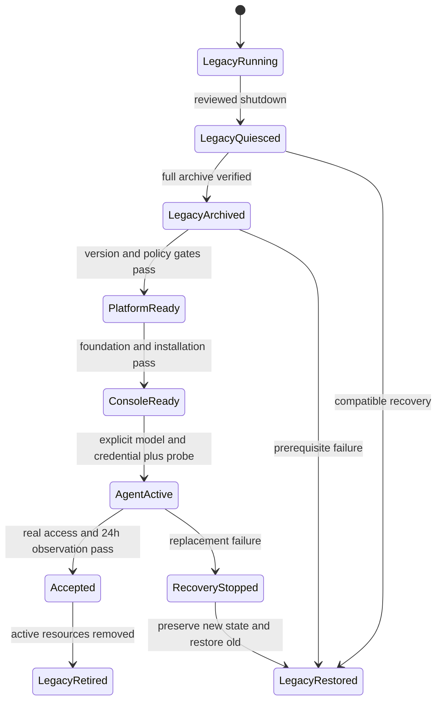

# Data Model and State Transitions

This is an infrastructure control model, not a new application database schema.
OCE owns its native schema; repository records hold desired state and sanitized
receipts. Secret values and personal contents never belong in these records.

| Entity | Fields | Relationships and validation |
| --- | --- | --- |
| Platform target | source SHA, ordered version/image pairs, node IDs, expected starting versions, configuration hashes | Immutable inputs per maintenance stage; reject stale SHA, unexpected node/version, unsupported hop |
| Maintenance receipt | stage, node, before/after versions, image digest, health results, timestamp, status | References platform target; completed nodes are verified before resume, never blindly rerun |
| Policy qualification | source/render hashes, node/CNI/backend versions, reviewed policy fingerprints, scenario results | Bound to actual canary and every expanded node; missing or failed required case blocks rollout |
| Enterprise installation | source/image/chart pins, phase, namespaces, private origins, storage classes, secret references | Depends on accepted platform and foundation; no plaintext secret or mutable image tag |
| Model selection | provider, model ID, credential reference, activation enabled | Provider `openrouter`, model `openrouter/free`; key absent allowed only while inactive; never inherit old LiteLLM credentials |
| Agent binding | logical name `claw`, Namespace ID, Agent ID, ServicePrincipal ID, Configuration ID/generation, revision ID | At most one active desired binding; exact-Secret grants only; ambiguous discovery fails closed |
| Reconciliation journal | desired hash, operation, server IDs, observed generation/revision, outcome | Protected durable state; pending/unknown outcomes require discovery before another create |
| Legacy archive | source PVC UIDs/nodes, roots, compatible image/config hash, private artifact location, integrity results | Covers local DBs plus NAS; preserve old checkpoints; no import into new agent |
| Recovery set | database dump, tenant metadata/secrets, agent volume, bootstrap/auth/CA references, checksums | Encrypted/private independent copy; actual isolated restore required, not list/readability alone |
| Acceptance receipt | source/build/revision IDs, scenario IDs, timestamp, pass/fail and bounded reason | No tokens, prompts, conversation contents, or owner IDs; incomplete is not passed |

## Lifecycles

Replacement lifecycle; every activation transition requires its recorded gates.
Retirement leaves archives/retained volumes intact.
`RecoveryStopped` requires the agent stopped through OCE and zero verified runtime
Pods/writers before API/worker shutdown. Control-plane shutdown alone does not
establish this state. Preserve new state before restoring the legacy service.

Installation upgrade states are `serving -> preflight -> quiesced -> migrating
-> serving`. A preflight failure leaves the current installation serving. A later
failure enters `recovery-stopped`; no automatic resume follows uncertain migration.
First install enters migration only when both old Deployments are absent.

Agent reconciliation states are `unbound -> discovered/created -> configured ->
deployed -> verified`. An unknown operation outcome enters `reconcile-required`.
An exact lookup or matching audit/owned-resource evidence must resolve it; absence
of a local journal entry is never proof that creation failed.

## Storage and Retention

- Preserve `ai/openclaw` NAS content and all retained local runtime PVs. Local
  parent/child PVs describe the same physical database tree; do not count them as
  independent copies. Include the previously retained full archives and runtime
  checkpoint in the inventory.
- Fresh OCE gateway state uses its own 10Gi RWO claim. Match the exact namespace,
  agent ownership and PVC UID for backups/restores; no legacy claim adoption.
- Application/migration database roles and bootstrap/operator credentials have
  separate consumers. Keep bootstrap output durable; losing it is not repaired
  by repeating first-run initialization.
- A recovery set is complete only when hashes, database integrity, credential
  references and an actual isolated restoration all verify. Private backup data
  must be stored outside the source failure domain.
- Stopping or retiring an Application is not permission to prune retained data.
  Agent deletion can delete OCE-owned storage; retain/archive explicitly first.
- Source state remains immutable during archive verification. A failed or partial
  archive has no completion marker and cannot authorize retirement.
